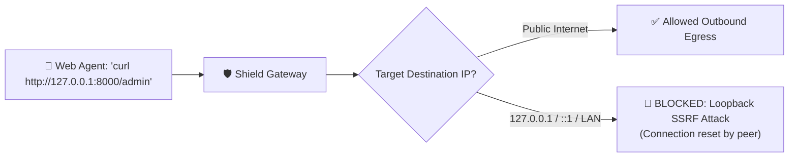

# Recipe: Loopback SSRF Prevention Gateway

> **Use Case ID:** `SHI-UC-02`  
> **Target Audience:** Security Engineers, Web Scraper Developers, Agent Operators  
> **Platform Mechanism:** Loopback Wire Guard & Packet Filter  

---

## 1. Problem Statement

Autonomous web agents given browsing or scraping capabilities (fetching URLs, querying REST APIs) can be manipulated via Prompt Injection to perform Server-Side Request Forgery (SSRF). Attackers instruct the agent to probe internal developer services running on `http://127.0.0.1:3000`, `http://localhost:5432`, or cloud metadata endpoints (`http://169.254.169.254`).

---

## 2. When to Use This

Use the **Shield SSRF Gateway** whenever allowing an autonomous agent to perform outbound HTTP fetching. Shield strictly isolates the agent's network stack, dropping any request targeting loopback addresses (`127.0.0.0/8`, `::1`), private LAN subnets (`10.0.0.0/8`, `192.168.0.0/16`), or link-local metadata services.

---

## 3. Architecture & Dataflow



---

## 4. Prerequisites

1. **Shield CLI:** Available on `$PATH`.

---

## 5. Step-by-Step Recipe

### Step 1: Start the Gateway in SSRF Guard Mode
```bash
shield gateway start --block-internal --block-metadata
```

### Step 2: Route Agent Fetch Requests Through Gateway
```bash
export HTTP_PROXY="http://127.0.0.1:8080"
```

### Step 3: Test SSRF Interception
Attempting to fetch a local admin service:
```bash
curl -s -x http://127.0.0.1:8080 http://127.0.0.1:3000/internal-metrics
```
Output:
```text
HTTP/1.1 403 Forbidden
X-Shield-Block-Reason: SSRF_TARGET_PROHIBITED (Loopback IP: 127.0.0.1)
```

---

## 6. Verification & Expected Output

Verify DNS rebinding protection: Shield resolves the hostname *before* routing and drops the packet if the resolved IP resolves to a private subnet.

---

## 7. Security Invariants & Blast Radius

- **DNS Rebinding Resistance:** Hostnames that resolve to public IPs but redirect to `127.0.0.1` are detected and terminated during the TCP handshake.
- **Fail-Closed Default:** Unresolvable domains or non-HTTP protocols are dropped immediately.

---

## 8. Troubleshooting & Common Pitfalls

- **Issue:** Legitimate local API testing is blocked by the gateway.  
  **Remediation:** Whitelist a specific port for testing:
  ```bash
  shield gateway --allow-local-port 8081
  ```
