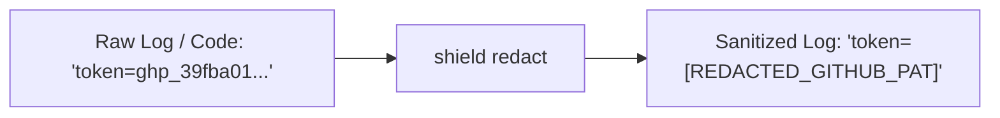

# Recipe: CLI Entropy Scanner & Redaction Testing

> **Use Case ID:** `SHI-UC-03`  
> **Target Audience:** Developers, Git Pre-Commit Hook Authors, SecOps  
> **Platform Mechanism:** Standalone CLI Redaction Engine  

---

## 1. Problem Statement

Developers frequently need to sanitize log files, terminal transcripts, or configuration files before sharing them in public bug reports, Slack channels, or GitHub issues, without running a full proxy daemon.

---

## 2. When to Use This

Use **`shield redact`** for fast, scriptable text redaction from the terminal. Shield calculates Shannon entropy and matches regex signatures, outputting the sanitized text directly to stdout.

---

## 3. Architecture & Dataflow



---

## 4. Prerequisites

1. **Shield Installed:** Version 1.0+ on `$PATH`.

---

## 5. Step-by-Step Recipe

### Step 1: Redact a Single String
```bash
shield redact "Error: failed to connect with token ghp_A1B2C3D4E5F6G7H8I9J0"
```
Output:
```text
Error: failed to connect with token [REDACTED_GITHUB_PAT]
```

### Step 2: Redact a File
```bash
cat server.log | shield redact > server-sanitized.log
```

### Step 3: Embed in Pre-Commit Hook
In `.git/hooks/pre-commit`:
```bash
#!/usr/bin/env bash
if git diff --cached | shield redact --detect-only; then
    echo "⚠️ Commit blocked: High-entropy secret detected in staged changes!"
    exit 1
fi
```

---

## 6. Verification & Expected Output

Test Shannon entropy detection on random high-entropy strings:
```bash
shield redact "secret=9f8e7d6c5b4a32109876543210abcdef"
```
Output replaces the high-entropy hex string with `[REDACTED_HIGH_ENTROPY]`.

---

## 7. Security Invariants & Blast Radius

- **Pure Local Execution:** 100% in-memory string processing with zero network calls.

---

## 8. Troubleshooting & Common Pitfalls

- **Issue:** Benign hash string (e.g. git commit SHA) is redacted as high entropy.  
  **Remediation:** Adjust entropy threshold:
  ```bash
  shield redact --entropy-threshold 4.8 <file>
  ```
